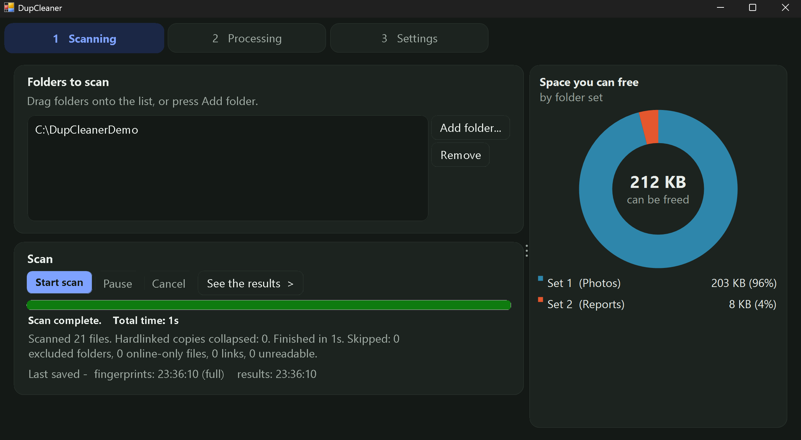
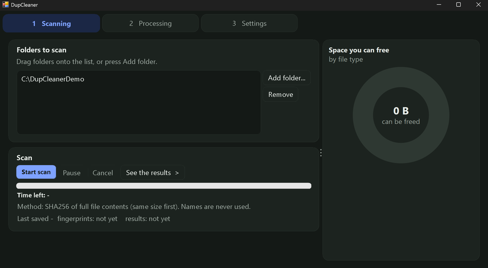
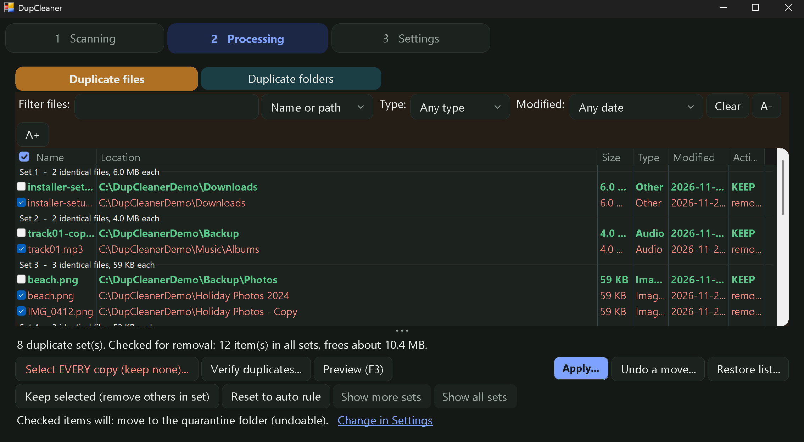
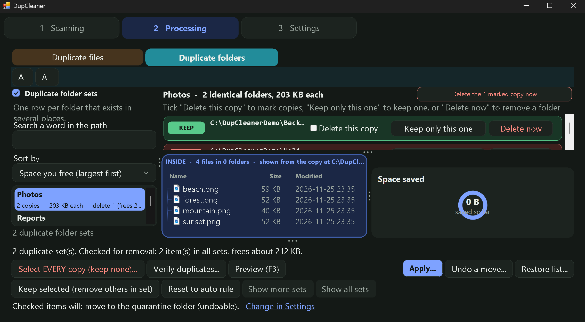
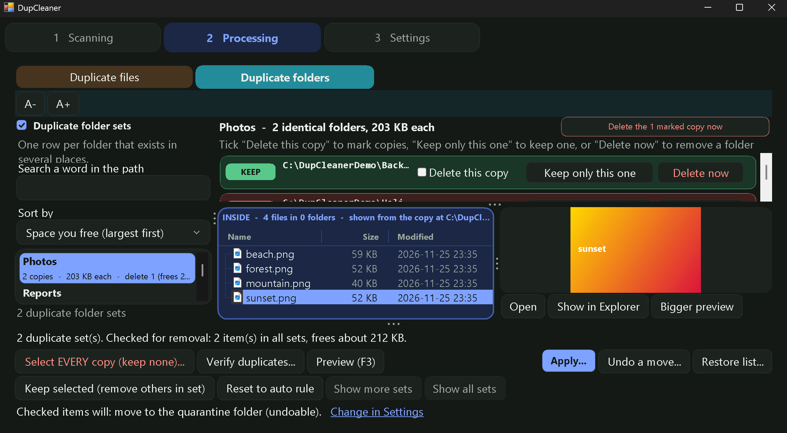
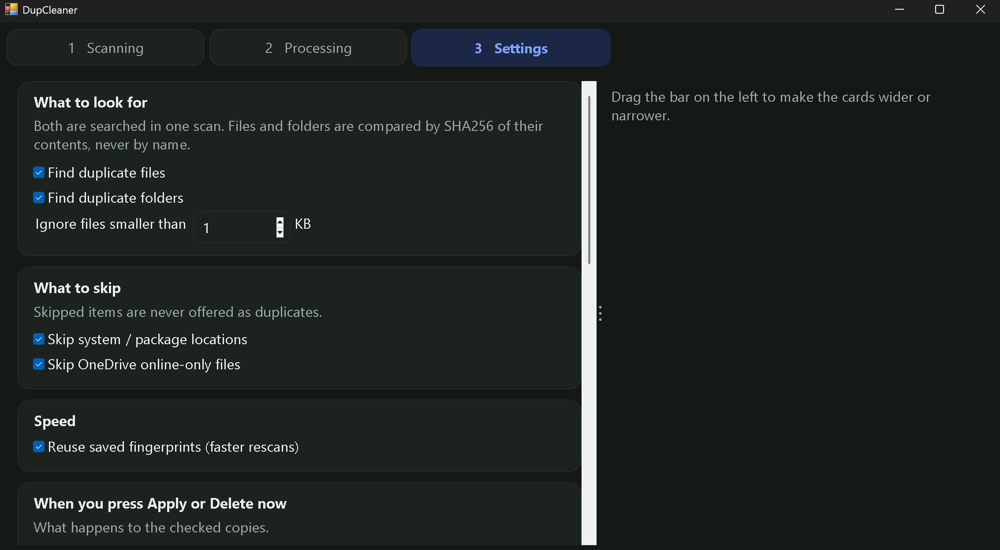
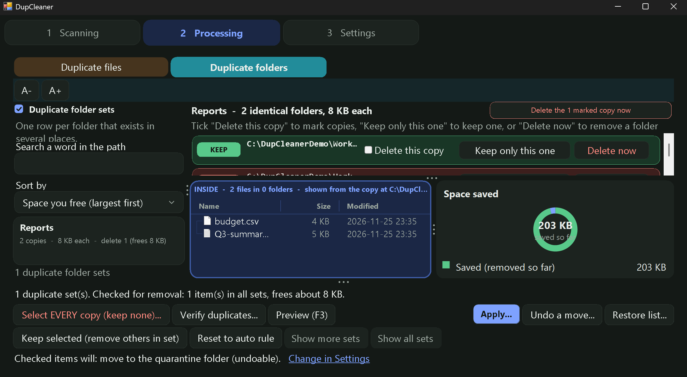

# DupCleaner

A Windows desktop tool that finds **duplicate files and duplicate folders** by their real contents (SHA-256, never by name), shows them live while it scans, and lets you remove the extra copies safely.



## Goal

Disks fill up with copies: photo backups, "Copy of" folders, old report versions, installers downloaded twice. DupCleaner's goal is to let you reclaim that space **without risk**: you see exactly what is identical, what you would keep, and what you would remove, and by default nothing is deleted for good (removed items go to a quarantine folder you can undo).

## Features

- **Content-based matching** - files and whole folders are compared by SHA-256 of their contents, so renamed copies (`beach.png` vs `IMG_0412.png`) are still found.
- **Duplicate files and duplicate folders** in two separate result tabs, with a live "space you can free" chart.
- **Folder sets**: one row per folder that exists in several places, with an INSIDE panel (Name / Size / Modified, like Explorer) and a picture/text/PDF preview.
- **Filters**: by name or path, file type, and modified date (including a custom range).
- **Safe removal**: move to a quarantine folder (undoable), send to the Recycle Bin, or delete permanently. Nothing happens until you press Apply or Delete now and confirm.
- **Undo a move** and **Restore list**: bring quarantined items back, or reload a saved result list.
- **Force delete** for stubborn folders: clears read-only/hidden/system flags, handles long paths, and tells you when a file is held by another program or blocked by permissions.
- **Verify duplicates** re-checks the chosen copies byte by byte before you delete.
- **Space saved** donut that tracks how much you have freed so far.
- **Fast re-scans**: a hash cache that only trusts entries while size and modified time still match; session and layout are restored on start.
- **Arrangeable layout**: every inner panel can be resized or reordered by dragging, with a Reset layout button. Dark and light themes follow Windows.
- Skips links/junctions and online-only (cloud placeholder) files so a scan never wanders outside what you picked.
- Everything runs locally. The app makes no network connections.

## Install and run

Requirements: Windows 10/11 with Windows PowerShell 5.1 (built in).

- **Script:** double-click `DupCleaner.cmd` (starts `DupCleaner.ps1` with no console window).
- **Single exe (no .ps1 beside it):** run `Build-Exe.ps1` once. It uses the C# compiler that ships with Windows (nothing to download) and creates `DupCleaner.exe` with the script embedded. Re-run it after changing the script.

Settings, session, hash cache and logs live in `%LOCALAPPDATA%\DupCleaner`.

## Tutorial (with fake files)

The screenshots below use a made-up folder, `C:\DupCleanerDemo`. You can recreate it in PowerShell:

```powershell
$r = 'C:\DupCleanerDemo'
'Holiday Photos 2024','Holiday Photos - Copy','Backup\Photos','Work\Reports','Work\Reports (old)','Downloads','Music\Albums' |
  ForEach-Object { New-Item -ItemType Directory "$r\$_" -Force | Out-Null }
$rnd = New-Object Random 7
function Blob($p, $mb) { $b = New-Object byte[] ($mb * 1MB); $rnd.NextBytes($b); [IO.File]::WriteAllBytes($p, $b) }
# four "photos" (any small files will do), copied to two other folders, one renamed
'beach','mountain','sunset','forest' | ForEach-Object { Blob "$r\Holiday Photos 2024\$_.png" 1 }
Copy-Item "$r\Holiday Photos 2024\*" "$r\Holiday Photos - Copy"; Copy-Item "$r\Holiday Photos 2024\*" "$r\Backup\Photos"
Rename-Item "$r\Holiday Photos - Copy\beach.png" 'IMG_0412.png'
# two report files, copied to an "old" folder
Set-Content "$r\Work\Reports\Q3-summary.txt" ('Quarter 3 summary ' * 300)
Set-Content "$r\Work\Reports\budget.csv" ((1..300 | % { "line$_,$($_*13)" }) -join "`r`n")
Copy-Item "$r\Work\Reports\*" "$r\Work\Reports (old)"
# an installer downloaded twice, a song copied, and one unique file
Blob "$r\Downloads\installer-setup.bin" 6; Copy-Item "$r\Downloads\installer-setup.bin" "$r\Downloads\installer-setup (1).bin"
Blob "$r\Music\Albums\track01.mp3" 4; Copy-Item "$r\Music\Albums\track01.mp3" "$r\Backup\track01-copy.mp3"
Blob "$r\Downloads\unique-video.bin" 3
```

### 1. Scan

Open **1 Scanning**, press **Add folder...** (or drag a folder onto the list) and choose `C:\DupCleanerDemo`, then **Start scan**. Results appear live; the chart on the right shows how much space each duplicate set could free.




### 2. Look at duplicate files

When the scan ends, **2 Processing** opens on the tab that has results. **Duplicate files** lists every identical group. Copies pre-marked for removal are checked; the first copy of each group is kept. Use the filter row to narrow by name, type or date.



### 3. Look at duplicate folders

**Duplicate folders** shows one row per folder that exists in several places (for example `Photos` in two backups). Pick a set on the left: each copy gets a card with **KEEP** or **DELETE**, and buttons **Delete this copy**, **Keep only this one**, and **Delete now**. The blue **INSIDE** panel lists the files with Name, Size and Modified; click a picture to preview it.




### 4. Choose what happens to removed items

**3 Settings** decides what Apply and Delete now do: move to quarantine (default, undoable), send to the Recycle Bin, or delete permanently. It also holds the filters for what to look for/skip, speed options, text size, and **Reset layout**.



### 5. Apply, then undo if you change your mind

Press **Apply...** (or **Delete now** on one card) and confirm. Space freed is added to the **Space saved** donut that appears whenever no file is selected. If it was a quarantine move, **Undo a move...** puts everything back.



### If a folder will not delete

DupCleaner tells you why: *in use by another program* (close that program and try again) or *a permission problem* (run DupCleaner as administrator). Tick **Force delete** in Settings to clear read-only/hidden/system flags and use long-path deletion first.

## Safety notes

- Nothing is removed until you confirm; the default is the undoable quarantine.
- Links/junctions are never followed, and an entry already gone from disk is dropped as stale instead of failing.
- Review before using **Select EVERY copy (keep none)** or permanent delete: they cannot be undone.
- No telemetry, no network access.

## Project files

| File | Purpose |
|---|---|
| `DupCleaner.ps1` | The whole application (PowerShell 5.1 + WinForms) |
| `DupCleaner.cmd` | Launcher without a console window |
| `DupCleanerHost.cs`, `Build-Exe.ps1`, `DupCleaner.ico` | Build a single `DupCleaner.exe` |
| `docs/images/` | Screenshots (made with fake demo files) |

## License

MIT - see `LICENSE`.